<div align="center">

# Run It Backwards

**ERA V5 · Session 13** · *Reversible training of a 20M GPT, measured on one A100*

I trained a 20M-parameter GPT on 50M FineWeb-Edu tokens several ways: storing every activation, rebuilding them with a reversible stack, and using the freed memory for the largest batch the card can hold. Then I kept pulling on the threads the measurements left loose.

[**🕹️ Companion site**](https://sourav-dhar.github.io/era-v5-s13-reversibility/) · [**📓 Notebooks**](notebooks/) · [Results JSON](results/full/) · [The reversible backward, 60 lines](s13/reversible.py)

</div>

---

## At a glance

| The brief asked | What I measured |
|---|---|
| **1 · Train a 20M LLM for 50M tokens; fix a batch size you can run** | 21.2M non-embedding parameters, 1,525 steps of 32 × 1,024 tokens. The largest batch the standard model trains on a 40 GB A100 is **44**, so I fixed the batch at **32** for every comparison. Validation loss **4.448**, **200k tokens/s**, peak **24.96 GiB**. |
| **2 · Train again with reversibility; report which variant worked (midpoint, Euler, …)** | I trained **7 variants**: midpoint, blend (the "a" rule Lightning LM uses) and leapfrog, each with an *Euler* or a *no-kick* start, plus the integrator library's defaults. **Midpoint with a no-kick start won: 4.506** (+0.058 vs standard), at **163k tokens/s (0.81×)** and **19.05 GiB (−24%)**. Blend was worst, by more than 0.4. |
| **3 · Train again with reversibility at the maximum batch** | Reversible alone fits **57** sequences, because the 50k-vocab logits dominate memory. Reversible plus a chunked LM head fits **1,152 sequences (1.18M tokens per step), 26× the standard model**. Trained at 1,117 sequences, though, the 50M-token budget is only **43 optimizer steps**: validation loss **7.56**, at 124k tokens/s and 35.05 GiB. The maximum batch is a memory *capability*. At this token budget it is not a training recipe. |
| **Other findings** | (a) Blend lost because **its gradients were wrong, not its rule**. The bottom of the stack can't be rebuilt in bf16: the gradient cosine for layer 0 fell to **0.30**. (b) **Anchoring**, which stores the bottom two states too (3 MiB per sequence), fixed it. Blend went from 4.896 to **4.444** and leapfrog from 4.530 to **4.421**, level with standard training. A second seed puts anchored leapfrog at **4.428** against standard's **4.441**, so the two are indistinguishable. Plain midpoint's +0.07 gap is five times the seed noise. (c) Memory stays **flat from 2 to 64 layers** (each added layer costs 151 MiB stored, 20 MiB reversible). (d) At batch 1 the reversible stack trains a **1,048,576-token sequence** on the 40 GB card (32.1 GiB, the probe's cap); the standard model stops at 193,536. |

> The lesson says reversibility *"moves the constraint"* (§17). In a 20M model with a 50k vocabulary I watched it move twice. First from the layers to the **LM head**: at batch 32, the logits are 16 of the 25 GiB. Then, once the head was chunked, from memory to **numerical precision at the bottom of the stack**.

---

## Setup

| | |
|---|---|
| **Model** | GPT, 12 layers × 384 wide × 6 heads, pre-norm, RoPE, GELU MLP (4×), no biases, LM head tied to the embedding · **21,243,264 non-embedding parameters** (40,560,000 with the 50,304 × 384 embedding) |
| **Data** | FineWeb-Edu `sample-10BT`, GPT-2 BPE · 52M training tokens and 2M held-out tokens, from separate documents · cut into 1,025-token windows and **shuffled once with a fixed seed. Every run sees the same tokens in the same order**, whatever its batch size |
| **Training** | 50M tokens per run · AdamW (0.9, 0.95), peak LR 2e-3, 5% warmup, cosine to 10%, clip 1.0 · bf16 autocast with an **fp32 residual stream** · **dropout 0 and weight decay 0 in every run**, baseline included, so the residual stream is the only thing that changes |
| **Evaluation** | validation loss on 0.5M held-out tokens every 5M tokens, and on **2M held-out tokens** at the end |
| **Hardware** | Modal **A100-SXM4-40GB**, torch 2.8 · every memory limit is a 40 GB limit (see [what went wrong](#what-went-wrong-on-the-way)) |
| **Notebooks** | [01 baseline](notebooks/01_baseline.ipynb) · [02 reversible variants](notebooks/02_reversible_variants.ipynb) · [03 max batch](notebooks/03_max_batch.ipynb) · [04 memory anatomy](notebooks/04_memory_anatomy.ipynb), all executed, with outputs |

---

## The three runs the brief asked for

| | Run 1 · standard | Run 2 · reversible | Run 3 · reversible at max batch |
|---|--:|--:|--:|
| what | stores every activation | midpoint h = 0.5, no-kick start | midpoint, no-kick start + chunked head |
| micro-batch × tokens | 32 × 1,024 | 32 × 1,024 | 1,117 × 1,024 |
| optimizer steps | 1,525 | 1,525 | 43 |
| **final validation loss** | **4.4480** | **4.5064** | **7.5572** |
| final train loss | 4.3943 | 4.4520 | 7.5414 |
| **tokens / second** | **199,982** | **162,563** | **123,548** |
| **peak memory** | **24.96 GiB** | **19.05 GiB** | **35.05 GiB** |
| wall time · cost | 265 s · $0.15 | 323 s · $0.19 | 415 s · $0.24 |

---

## 1 · The baseline, and fixing the batch

I didn't guess the batch. [`probe.max_batch`](s13/probe.py) doubles the micro-batch until a full training step (forward, backward and the AdamW update) runs out of memory, then bisects. The standard model trains at **44** sequences of 1,024 tokens and fails at 45. I took the largest power of two with at least 10% headroom: **32**.

<p align="center">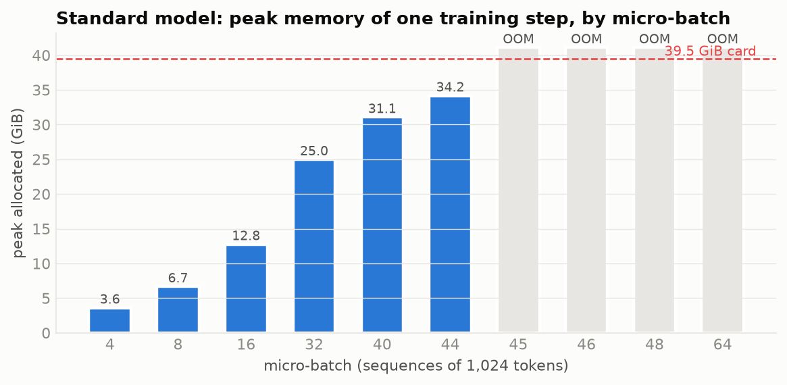</p>

I also trained **activation checkpointing** on the same tokens. It is the honest reference for any trick that trades compute for memory. It reached **4.4486** (standard: 4.4480) at **170k tokens/s (0.85×)** and **19.56 GiB**. Any reversible run has to beat *that* on memory to be worth its constraints, not just the baseline.

<p align="center">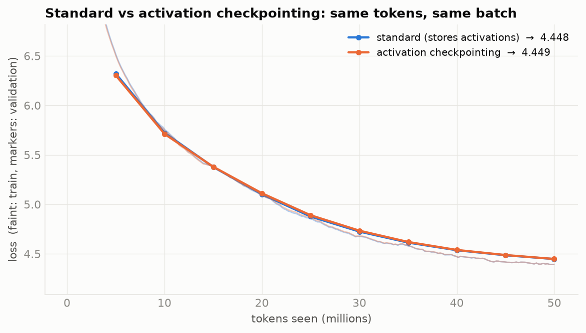</p>

---

## 2 · Reversibility: which variant worked

### The rule, in one line

Write $s_k$ for the residual stream entering layer $k$, and $f_k$ for the whole block (attention then MLP) minus its input. Every integrator I tried is a *two-step* rule:

$$s_{k+1} = \alpha\, s_{k-1} + \beta\, s_k + \gamma\, f_k(s_k) \quad\Longleftrightarrow\quad s_{k-1} = \frac{s_{k+1} - \beta\, s_k - \gamma\, f_k(s_k)}{\alpha}$$

| integrator | α | β | γ | paper |
|---|:-:|:-:|:-:|---|
| **midpoint** | 1 | 0 | 2h | Gal et al. 2025, Eq. 4, the lesson's rule |
| **blend** | a | 1−a | h | Eq. 15. Lightning LM runs a = 0.5, h = 0.25 with an Euler start |
| **leapfrog** | −1 | 2 | h² | Eq. 6 |

**What "Euler" means here.** The plain Euler step $s_{k+1} = s_k + h f_k(s_k)$ *is* the standard residual block, and lesson §16 shows it can't be reversed. Euler enters reversible training in two other places, and I tested both:

1. A two-step rule needs two starting states. The **Euler start** makes the second with one ordinary step, $s_1 = s_0 + h f_0(s_0)$. The **no-kick** start uses $s_1 = s_0$. These are Lightning LM's `bootstrap = euler` and its library default `no_kick`.
2. Gal et al. (§3.2) show that the blend rule, with its coefficients drawn at random per layer, behaves like forward Euler in expectation.

### Results: 7 variants, same tokens, same batch

| variant | val loss | Δ vs standard | tokens/s | peak |
|---|--:|--:|--:|--:|
| standard | 4.4480 | — | 199,982 | 24.96 GiB |
| activation checkpointing | 4.4486 | +0.0006 | 170,372 | 19.56 GiB |
| **midpoint h=0.5, no-kick start** | **4.5064** | **+0.0584** | 162,563 | **19.05 GiB** |
| midpoint h=0.5, Euler start | 4.5182 | +0.0702 | 162,835 | 19.05 GiB |
| leapfrog h=1, Euler start | 4.5299 | +0.0819 | 157,239 | 19.05 GiB |
| leapfrog h=1, no-kick start | 4.5427 | +0.0947 | 156,650 | 19.05 GiB |
| blend a=0.5 h=0.25, no-kick start | 4.8761 | +0.4281 | 156,627 | 19.05 GiB |
| blend a=0.5 h=0.25, Euler start (Lightning LM) | 4.8957 | +0.4477 | 157,350 | 19.05 GiB |
| blend a=0.95 h=0.05, no-kick (library defaults) | 4.9753 | +0.5273 | 156,523 | 19.05 GiB |

<p align="center">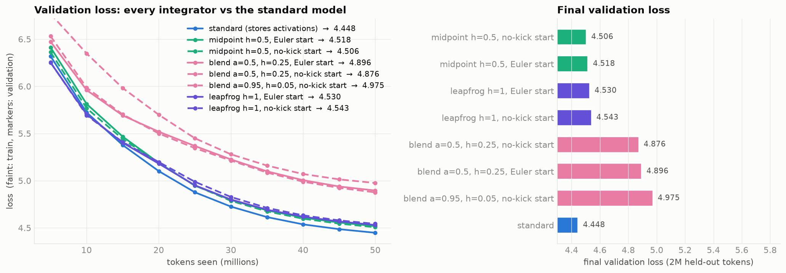</p>

**My answer to the brief: midpoint worked best. The choice of start mattered far less than the choice of rule.** The no-kick start beat the Euler start for midpoint (−0.012) and blend (−0.020). For leapfrog the Euler start was better (−0.013). Gaps of 0.01–0.02 are within the seed-to-seed noise I measure in §4 (two seeds of the same configuration differ by 0.013–0.015), so I read the start as a wash. The gap between the rules, 0.4 between midpoint and blend, is twenty times larger.

Every reversible run costs **0.78–0.81× the standard speed**, better than the 0.67–0.77× the paper's 30–50% overhead estimate implies. A backward pass costs about twice a forward, so recomputing the whole step's forward would give 0.75×. Only the stack is recomputed, though, not the 50k-wide head or the optimizer step, so the measured cost is lower. All of them peak at **19.05 GiB, 0.5 GiB below checkpointing**. That gap is small because, at batch 32, the LM head and not the stack holds most of the memory (§3).

### Before training: stability says the backward pass decides

Set $f = 0$ and each rule becomes the recurrence $z^2 = \beta z + \alpha$. The forward pass multiplies errors by $\max|z|$ per layer. The *reconstruction runs the recurrence backward*, so it multiplies them by $\max|1/z|$.

| rule | roots | backward growth per layer | over 11 layers |
|---|---|--:|--:|
| midpoint | ±1 | ×1.00 | ×1 |
| blend a = 0.5 | 1, −0.5 | **×2.00** | **×2,048** |
| blend a = 0.95 | 1, −0.95 | ×1.05 | ×1.8 |
| leapfrog | 1, 1 (double) | ×1.00, growing linearly | — |

Blend's damped forward rule, the root inside the unit circle, is exactly what makes its *backward* rule unstable. Gal et al. require |α| = 1 for this reason. §4 shows what that does in practice.

### An ablation that proved me wrong

My first explanation for blend's deficit was its step: γ = h = 0.25 gives each block a quarter of midpoint's weight (γ = 2h = 1). So I trained the step sizes against each other (all with no-kick starts):

| rule | h | γ (weight on the block) | val loss |
|---|--:|--:|--:|
| midpoint | 0.25 | 0.5 | **4.4928** |
| midpoint | 0.5 | 1 | 4.5064 |
| midpoint | 1 | 2 | 4.5261 |
| blend a=0.5 | 0.25 | 0.25 | 4.8761 |
| blend a=0.5 | 1 | **1** | **6.0454** |

At the *same* weight γ = 1, blend is 1.5 worse than midpoint, and raising its step made it much worse, not better. So the step size wasn't the cause. The ablation did turn up the best plain reversible configuration, **midpoint with h = 0.25, at +0.045 from standard**. The trend says smaller steps help midpoint.

<p align="center">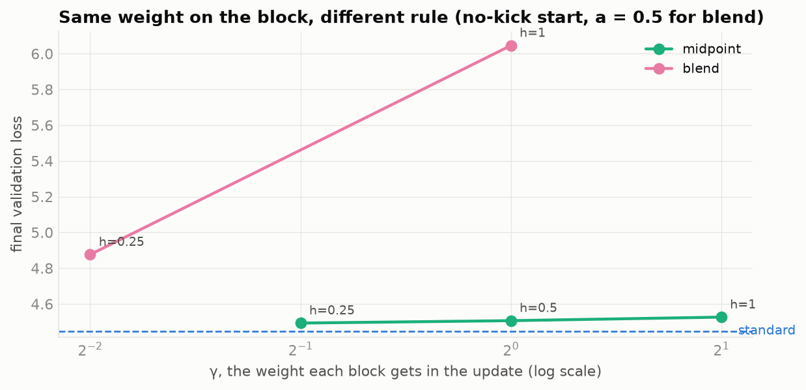</p>

---

## 3 · The maximum batch

"Maximum batch" depends on what else is in memory, so I measured it for eight configurations: four ways to run the stack, each with the head as usual or **chunked**. The chunked head computes the loss 4,096 tokens at a time and recomputes the logits in backward.

| | full logits | chunked head |
|---|--:|--:|
| standard | 44 | 186 |
| **reversible rule, plain autograd** (control) | **44** | **184** |
| activation checkpointing | 64 | 1,016 |
| **reversible, custom backward** | **57** | **1,152** |

<p align="center">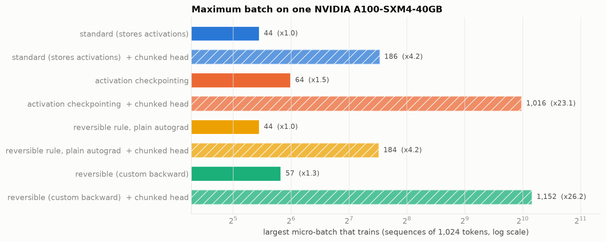</p>

Four things in this table:

* **The control is the most important row.** Write the reversible rule and let autograd differentiate it, and memory is *identical* to the standard model (44 and 184). The architecture saves nothing on its own; the saving comes entirely from the custom backward that throws the states away.
* **Reversibility alone buys only 1.3×**, from 44 to 57. At batch 32 the reversible backward removes 5.9 GiB from a 25 GiB step (8.99 → 3.07 GiB with the chunked head). The rest is the training state (0.6 GiB) and **the logits: 1,024 × 50,304 values per sequence, in bf16, again in fp32 for the loss, and again for their gradients, about 16 GiB at batch 32**. Reversibility can't touch them.
* **Reversible plus chunked head: 1,152 sequences, 26× standard.** Once the head is chunked, the stack is the only thing left that grows with batch. There, the reversible backward beats checkpointing by 13%, because checkpointing still stores every block's input.
* The full-logit reversible run stops at 57 with a **measured peak of 33.5 GiB, 6 GiB under the cap**. Batch 58 needs one contiguous 12 GB buffer for the fp32 logits, so the limit there is most likely allocator fragmentation rather than total memory. The standard model shows the same pattern: 34.2 GiB at 44, failing at 45.

<p align="center">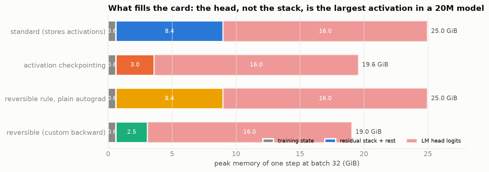</p>

### Does a bigger batch buy speed? Not on this model

| tokens/s (thousands) at batch → | 4 | 8 | 16 | 32 | 64 | 128 | 256 | 512 |
|---|--:|--:|--:|--:|--:|--:|--:|--:|
| standard | 143 | 186 | 198 | **202** | OOM | | | |
| standard + chunked head | 124 | 153 | 161 | 162 | 165 | **167** | OOM | |
| checkpointing + chunked head | 83 | 121 | 141 | 142 | 145 | **147** | 145 | 140 |
| reversible | 110 | 152 | 160 | **163** | OOM | | | |
| reversible + chunked head | 104 | 130 | 134 | 136 | 139 | **141** | 139 | 134 |

Every configuration saturates by batch 16–32. The paper's 2× throughput gain came at **96 layers**, where its standard model was stuck at batch 52 and couldn't fill the GPU. A 12-layer model at 1,024 tokens fills an A100 with 32 sequences, so for me the freed memory buys *capacity*, not speed.

<p align="center">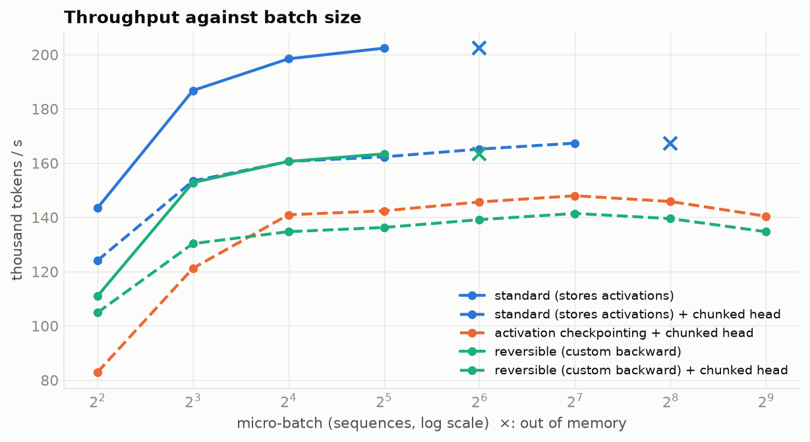</p>

### Training at the maximum batch

The same 50M tokens at a larger batch means fewer optimizer steps. I trained each max-batch configuration with the baseline learning rate and again with √-scaled LR (capped at 8e-3). I also trained the standard model at *its* maximum, to separate "reversibility" from "bigger batch".

| run | what | micro-batch | tokens / step | steps | LR | val loss | Δ vs baseline | tokens/s | peak |
|---|---|--:|--:|--:|--:|--:|--:|--:|--:|
| `baseline` | standard | 32 | 32,768 | 1,525 | 2.00e-03 | 4.4480 | +0.0000 | 199,982 | 24.96 GiB |
| `rev-midpoint-nokick` | reversible midpoint h=0.5, no-kick start | 32 | 32,768 | 1,525 | 2.00e-03 | 4.5064 | +0.0584 | 162,563 | 19.05 GiB |
| `std-max` | standard | 42 | 43,008 | 1,162 | 2.00e-03 | 4.4835 | +0.0355 | 204,079 | 32.65 GiB |
| `std-max-sqrtlr` | standard | 42 | 43,008 | 1,162 | 2.29e-03 | 4.5349 | +0.0869 | 204,031 | 32.65 GiB |
| `rev-max` | reversible midpoint h=0.5, no-kick start | 55 | 56,320 | 887 | 2.00e-03 | 4.7118 | +0.2638 | 166,839 | 32.37 GiB |
| `rev-max-sqrtlr` | reversible midpoint h=0.5, no-kick start | 55 | 56,320 | 887 | 2.62e-03 | 5.1661 | +0.7181 | 166,809 | 32.37 GiB |
| `rev-chunk-max` | reversible midpoint h=0.5, no-kick start + chunked head | 1117 | 1,143,808 | 43 | 2.00e-03 | 7.5572 | +3.1092 | 123,548 | 35.05 GiB |
| `rev-chunk-max-sqrtlr` | reversible midpoint h=0.5, no-kick start + chunked head | 1117 | 1,143,808 | 43 | 8.00e-03 | 7.6856 | +3.2376 | 123,611 | 35.05 GiB |

<p align="center">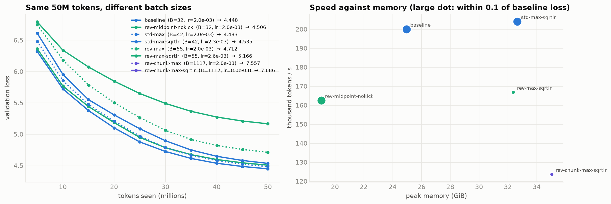</p>

**What this taught me: the maximum batch is a capability, not a recipe, at 50M tokens.**

* **Fewer steps cost the reversible model more.** At its maximum batch of 42 the standard model takes 24% fewer steps and loses 0.036. At batch 55 the reversible model takes 42% fewer steps and loses 0.205 against its own batch-32 run.
* **√-scaled learning rates made every run worse**: standard +0.051, reversible +0.454, reversible with chunked head +0.128. The baseline's 2e-3 was already at the edge for this model, and the plain midpoint stack was the most sensitive. My guess, which I haven't tested, is that this connects to §4: its bottom layer already trains on a slightly wrong gradient.
* **At 1,117 sequences the whole run is 43 optimizer steps.** Validation loss stopped at 7.56 against 4.45. That is worse than the baseline was after its first 5M tokens (6.32). Throughput fell too, to 124k tokens/s, below the 141k the same configuration reaches at batch 128. The sweep above shows that decline starting past batch 128.
* So for a 20M model on 50M tokens, the freed memory is worth more as **context** (§4: a 1M-token sequence fits) or **depth** (memory flat from 2 to 64 layers) than as batch. A smaller batch with more steps won every comparison I ran.

---

## 4 · Anatomy: depth, length, time, and drift

### Depth: the saving really is independent of the number of layers

Batch 8 × 1,024 tokens, chunked head, 2 to 64 layers, one real training step each:

| layers | 2 | 8 | 16 | 32 | 64 |
|---|--:|--:|--:|--:|--:|
| standard | 2.98 | 3.86 | 5.05 | 7.41 | **12.14 GiB** |
| checkpointing | 2.74 | 2.93 | 3.19 | 3.69 | **4.71 GiB** |
| reversible | 2.73 | 2.85 | 3.01 | 3.33 | **3.96 GiB** |

Each added layer costs **151 MiB** with stored activations, **32 MiB** with checkpointing and **20 MiB** reversible. The reversible figure is *less than the 27 MiB of training state each layer brings* (1.77M parameters × 16 bytes), so its activation term is flat.

That slope is also a check on the lesson's §1 constant. Per token per hidden unit per layer, I measure **41.5 bytes**; Korthikanti et al.'s count with FlashAttention gives 34. The difference plausibly comes from what my layer keeps that their count doesn't: RoPE's fp32 copies of q and k, and LayerNorm inputs held in fp32 by autocast.

<p align="center">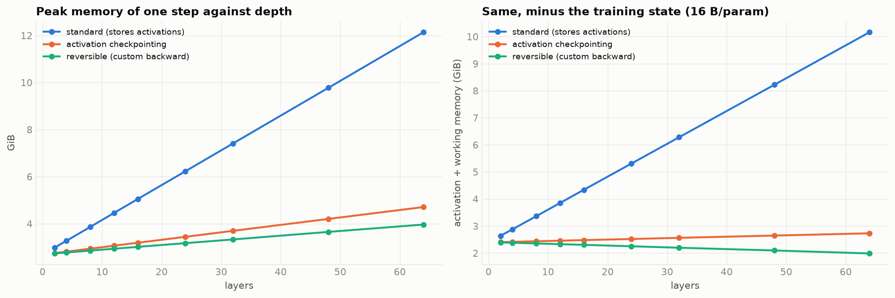</p>

### Length: the longest sequence one card trains

Batch 1, chunked head, doubling until a step fails:

| | longest sequence that trains |
|---|--:|
| standard | **193,536 tokens** |
| checkpointing | **1,015,808 tokens** |
| reversible | **1,048,576 tokens** (the probe cap; it never ran out of memory) |

The reversible stack reached the probe's cap of **1,048,576 tokens at 32.1 GiB**, at least **5.4× the standard model's limit**. Each added token costs about **199 KB** with stored activations, **39 KB** with checkpointing and **33 KB** reversible.

Checkpointing nearly ties at this extreme (1,015,808 tokens). At batch 1 with very long sequences both are dominated by the per-token working memory of one layer and of the logit chunk, and the extra layer inputs checkpointing stores are a small term. At 524,288 tokens the reversible stack uses 16.2 GiB against checkpointing's 19.2: a steady 15% advantage, not an order of magnitude. The order of magnitude is against *storing* activations.

### Time: memory through one training step

From the CUDA allocator's own trace (`torch.cuda.memory._record_memory_history`), with marker allocations of odd sizes splitting the step into forward, backward and optimizer:

<p align="center">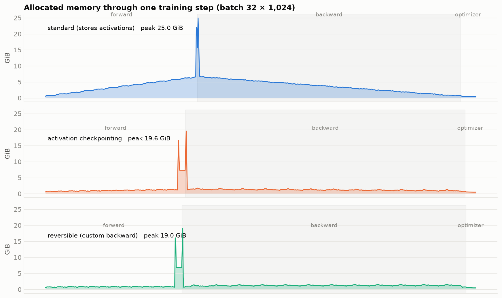</p>

The standard model's forward pass is a ramp: every layer adds its activations, up to about 6.6 GiB, and the backward pass walks the pile down again. Checkpointing and reversible stay near 1 GiB through both passes. All three are dominated by the same double spike at the loss, the logits going forward and their gradient coming back, which is 16–18 GiB that no stack trick can touch.

At this batch, checkpointing and reversible look almost identical. The block inputs checkpointing keeps are only about 0.6 GiB here, so the difference between them becomes decisive only once the head is chunked (§3: 1,016 vs 1,152 sequences).

### Drift: how exact is "exact" in bf16?

In float64 my backward matches autograd to 1e-9 ([tests](tests/test_reversible.py)). In training the blocks run in bf16, so each rebuilt state carries rounding error. I measured both the state error and the gradient error on every **trained** checkpoint, using held-out text:

| trained model | grad cosine, embedding | grad cosine, layer 0 | all other layers |
|---|--:|--:|--:|
| midpoint, no-kick | 0.999 | 0.988 | ≥ 0.9999 |
| midpoint, Euler start | 0.999 | 0.985 | ≥ 0.9999 |
| leapfrog, Euler start | 0.938 | **0.451** | ≥ 0.999 |
| blend a=0.5, no-kick | 0.865 | **0.405** | ≥ 0.997 |
| blend a=0.5, Euler start | 0.884 | **0.296** | ≥ 0.998 |

**The error lives at the bottom of the stack**, and the state norms say why. The embedding state has norm ≈ 1. The states above it reach 30–260 (midpoint, blend) and up to 1,150 (leapfrog, whose double root makes them grow almost linearly). Rebuilding $s_0$ means subtracting two large numbers to get a small one, which is **catastrophic cancellation**, so bf16 rounding of order $2^{-8}$ of a large number swamps it. Blend's ×2 backward growth makes it worse. Midpoint's norms also show its parasitic root at −1 directly: they alternate 71, 33, 77, 43, 84, … up the stack.

<p align="center">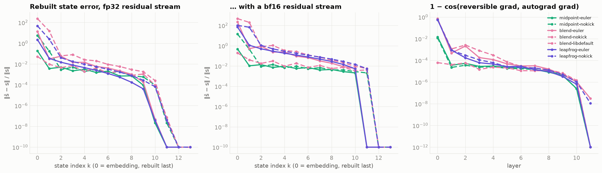</p>

So **blend's loss was not a failure of what its rule can model. Its bottom layers were trained on a gradient pointing 73° away from the true one** (cosine 0.30). The anchored run below confirms it: with the same rule and an exact bottom, blend matches standard training.

### A fix: anchor the bottom of the stack

If the bottom states can't be rebuilt, store them. **Anchoring** keeps $s_0$ and $s_1$ next to the top two states. That costs two more fp32 states, **3 MiB per sequence**, with no effect on speed and still independent of depth. The backward stays exact in float64; the test suite covers all six anchored variants.

| integrator | rebuilt to the bottom | **anchored** | change | vs standard (4.448) |
|---|--:|--:|--:|--:|
| midpoint, no-kick | 4.5064 | **4.4746** | −0.032 | +0.027 |
| blend a=0.5, Euler start | 4.8957 | **4.4442** | **−0.452** | −0.004 |
| leapfrog, Euler start | 4.5299 | **4.4207** | −0.109 | **−0.027** |

<p align="center">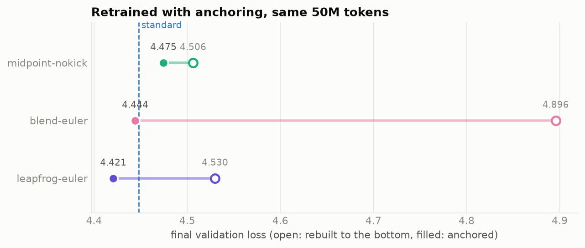</p>

The gradient tells the same story. I took the same trained checkpoints and measured them again with anchoring switched on. Every variant's worst layer goes from as low as 0.30 to at least 0.997:

| trained model | worst-layer cosine, rebuilt | **anchored** | layer-0 cosine, rebuilt | **anchored** |
|---|--:|--:|--:|--:|
| midpoint-nokick | 0.9882 | **1.0000** | 0.9882 | **1.0000** |
| midpoint-euler | 0.9855 | **1.0000** | 0.9855 | **1.0000** |
| blend-euler | 0.2955 | **0.9979** | 0.2955 | **1.0000** |
| blend-nokick | 0.4049 | **0.9974** | 0.4049 | **0.9999** |
| leapfrog-euler | 0.4513 | **0.9998** | 0.4513 | **1.0000** |
| leapfrog-nokick | 0.4250 | **0.9991** | 0.4250 | **0.9999** |
| blend-libdefault | 0.9999 | **0.9999** | 0.9999 | **1.0000** |

**Is it real? A second seed.** Every run above is one seed, and differences of 0.03 need a noise floor. I re-trained three configurations with a different initialisation (`seed = 1`); the data order is fixed separately, so it stays the same:

| configuration | seed 0 | seed 1 | mean | seed spread |
|---|--:|--:|--:|--:|
| standard | 4.4480 | 4.4336 | **4.4408** | 0.014 |
| midpoint, no-kick | 4.5064 | 4.5197 | **4.5130** | 0.013 |
| leapfrog, Euler start, anchored | 4.4207 | 4.4355 | **4.4281** | 0.015 |

The seed spread is about 0.014. Plain midpoint sits **+0.072** above standard, five times the noise, so that gap is real. Anchored leapfrog sits **−0.013** below it, inside the noise. I don't claim it beats standard training. I do claim it **reaches** it, at 77% of the peak memory and 79% of the speed, with activation memory that no longer grows with depth.

---

## Lesson claims, checked

| Lesson | What I measured | |
|---|---|---|
| §16 "The memory this saves does not depend on the number of layers." | Reversible peak grows 20 MiB per layer from 2 to 64 layers, less than the parameters themselves add; stored activations grow 151 MiB per layer | ✅ holds |
| §16 overhead "30% to 50% of a step" | 19–22% slower than standard at the same batch (0.78–0.81×), and 4–8% slower than checkpointing | ✅ better than claimed |
| §16 the paper's ~10× batch-size gain | 1.3× with a full-logit head, 26× with a chunked head. The gain depends on what else holds memory | ⚠️ depends on the head |
| §16 throughput 114 vs 57 samples/s "comes from the batch size the saved memory allows" | Throughput saturates by batch 32 for 12 layers. A bigger batch didn't add speed | ⚠️ needs depth |
| §16 "The forward pass must be deterministic" (dropout 0) | All runs used dropout 0. Determinism isn't enough on its own: bf16 rounding breaks reconstruction at the bottom of the stack | ⚠️ necessary, not sufficient |
| §16 "The rule is only marginally stable" | Blend's backward growth is ×2 per layer; its gradient cosine at layer 0 was 0.30 | ✅ holds, and it is the backward that is unstable |
| §17 reversibility "moves the constraint" | It moved twice: to the LM head (16 of 25 GiB at batch 32), then to the precision of the bottom layers | ✅ holds |
| §17 the length where one sequence stops fitting "moves out by about two orders of magnitude" | At batch 1: 193,536 tokens stored, at least 1,048,576 reversible (5.4×, capped by my probe). The per-token cost fell 6× (199 KB → 33 KB). A 12-layer model has less depth to remove than the lesson's 96-layer one | ⚠️ 6× here, grows with depth |
| §1 activations ≈ 34 bytes per token per hidden unit per layer | 41.5 bytes, measured from the depth slope | ✅ close |

---

## What it cost

Every run, on a Modal A100-40GB at $2.10 per GPU-hour, including evaluation:

| run | GPU | wall time | cost |
|---|---|--:|--:|
| `std-max` | A100-SXM4-40GB | 260 s | $0.152 |
| `std-max-sqrtlr` | A100-SXM4-40GB | 260 s | $0.152 |
| `baseline-s1` | A100-SXM4-40GB | 264 s | $0.154 |
| `baseline` | A100-SXM4-40GB | 265 s | $0.155 |
| `ckpt` | A100-SXM4-40GB | 309 s | $0.180 |
| `rev-max-sqrtlr` | A100-SXM4-40GB | 315 s | $0.184 |
| `rev-max` | A100-SXM4-40GB | 315 s | $0.184 |
| `rev-midpoint-euler` | A100-SXM4-40GB | 322 s | $0.188 |
| `rev-midpoint-nokick` | A100-SXM4-40GB | 323 s | $0.188 |
| `rev-anc-midpoint-nokick` | A100-SXM4-40GB | 323 s | $0.188 |
| `rev-abl-midpoint-h0.25` | A100-SXM4-40GB | 323 s | $0.188 |
| `rev-abl-midpoint-h1` | A100-SXM4-40GB | 324 s | $0.189 |
| `rev-midpoint-nokick-s1` | A100-SXM4-40GB | 325 s | $0.189 |
| `rev-blend-euler` | A100-SXM4-40GB | 334 s | $0.195 |
| `rev-leapfrog-euler` | A100-SXM4-40GB | 334 s | $0.195 |
| `rev-anc-leapfrog-euler` | A100-SXM4-40GB | 334 s | $0.195 |
| `rev-anc-leapfrog-euler-s1` | A100-SXM4-40GB | 335 s | $0.195 |
| `rev-blend-nokick` | A100-SXM4-40GB | 335 s | $0.195 |
| `rev-leapfrog-nokick` | A100-SXM4-40GB | 335 s | $0.195 |
| `rev-blend-libdefault` | A100-SXM4-40GB | 335 s | $0.196 |
| `rev-abl-blend-h1` | A100-SXM4-40GB | 335 s | $0.196 |
| `rev-anc-blend-euler` | A100-SXM4-40GB | 337 s | $0.197 |
| `rev-chunk-max-sqrtlr` | A100-SXM4-40GB | 414 s | $0.241 |
| `rev-chunk-max` | A100-SXM4-40GB | 415 s | $0.242 |
| **all 24 training runs** | | **129 min** | **$4.53** |

---

## What went wrong on the way

* **The head ate my first result.** My first GPU smoke test showed reversibility saving only 3 GiB at batch 16 (12.8 → 9.8 GiB). The "free memory" story didn't survive contact with a 50k vocabulary until I measured the head separately. That's why §3 has two columns.
* **Modal sometimes serves a bigger card.** One job asked for an A100-40GB and got an 80GB one. Its max-batch probe reported a 69 GiB peak, which is how I caught it. I deleted every probe from that container and made every GPU job refuse an 80GB card and retry. I also cap the allocator at 39.5 GiB with `torch.cuda.set_per_process_memory_fraction`, so all limits here are 40 GB limits. One ablation run had landed on that card, and its 177k tok/s looked suspiciously fast; I re-ran it on a 40 GB card (156.7k tok/s, same loss to 0.005).
* **My step-size hypothesis was wrong** (§2). The ablation is in the report because it changed my explanation.
* **An off-by-one in anchoring.** My first anchored backward replaced $s_1$ with $s_0$. The float64 exactness tests caught it before any GPU time was spent.
* **No `torch.compile`.** The max-batch probe builds a fresh model at every batch size, and recompiling per shape would have cost more than it saved. Every run is uncompiled, so the comparisons are like for like.

---

## How the reversible backward works

[`s13/reversible.py`](s13/reversible.py) holds one `torch.autograd.Function`, about 60 lines.

**Forward** (under `no_grad`): run the two-step rule up the stack and keep **only `s[L-1]` and `s[L]`** (plus `s[0]`, `s[1]` when anchored).

**Backward**: walk down the stack. At layer *k* it holds `s[k+1]`, `s[k]` and the adjoints `ḡ[k+1]`, `ḡ[k]`, and does four things:

```python
fx, gx, gθ = vjp(block_k, s[k], γ·ḡ[k+1])      # recompute f_k(s[k]) WITH a graph, backprop γ·ḡ through it
s[k-1]     = (s[k+1] − β·s[k] − γ·fx) / α       # rebuild the state below, Eq. (2)
ḡ[k]      += gx + β·ḡ[k+1]                      # adjoint of the state the block was evaluated at
ḡ[k-1]     = α·ḡ[k+1]                           # adjoint of the state two layers back
```

The block's graph lives only while `vjp` runs, so at any moment the memory holds two states, two adjoints and one layer's working set. The parameter gradients are *returned* from `backward` rather than written into `.grad`, so the function works with clipping, accumulation and hooks like any other op. Autocast is captured in `forward` and re-entered in `backward`, so the recomputed block runs at exactly the original precision.

**Tests** ([`tests/test_reversible.py`](tests/test_reversible.py), 14 tests, CPU, float64):

* The custom backward equals plain autograd through the same rule to < 1e-9, for all 11 integrator × start × anchoring combinations.
* Reconstruction recovers every state to < 1e-12.
* Checkpointing and the chunked loss reproduce the standard model exactly.
* The model has 20–22M non-embedding parameters.

## Repository

```
s13/                 model.py (GPT, 4 memory modes) · reversible.py (integrators + custom backward + anchoring)
                     train.py (one run = one dict) · probe.py (max batch/seq, depth, timeline, drift, grad fidelity)
                     data.py (FineWeb-Edu → uint16, fixed window order) · store.py (cached results) · viz.py
notebooks/           01_baseline · 02_reversible_variants · 03_max_batch · 04_memory_anatomy   (executed, with outputs)
tools/cells/*.md     notebook sources → tools/build_notebooks.py
tools/modal_app.py   data prep, smoke test, notebook execution and extra runs on Modal A100-40GB
results/full/        every run and probe as JSON: loss curves, tok/s, peak memory, cost
figures/             every figure in this README · docs/  the companion site
```

## Reproduce

```bash
pip install -r requirements.txt
python -m pytest -q tests                                   # exactness, CPU, ~30 s

modal run tools/modal_app.py --task prep                    # 52M + 2M FineWeb-Edu tokens
modal run tools/modal_app.py --task nb --names 01 --profile full
modal run tools/modal_app.py --task nb --names 02 --profile full
modal run tools/modal_app.py --task nb --names 03,04 --profile full
```

**On Colab:** open any notebook and choose a GPU runtime. The setup cell clones this repo, downloads the data and switches to the `colab` profile: the same 50M-token runs, two variants and smaller probes. Set `S13_PROFILE=quick` to run every cell on a tiny model in minutes.

## References

* E. Gal, M. Eliasof, J. Turek, U. Ascher, E. Treister, E. Haber. *Reversing Large Language Models for Efficient Training and Fine-Tuning*, 2025. [arXiv:2512.02056](https://arxiv.org/abs/2512.02056)
* Lightning LM technical report: integrator settings (step 0.25, a = 0.5, Euler bootstrap) and the dropout-zero requirement. [arXiv:2606.07404](https://arxiv.org/abs/2606.07404)
* V. Korthikanti et al. *Reducing Activation Recomputation in Large Transformer Models*, 2022 (the 34-byte activation count)
* ERA V5 Session 13 lesson, §16–17
